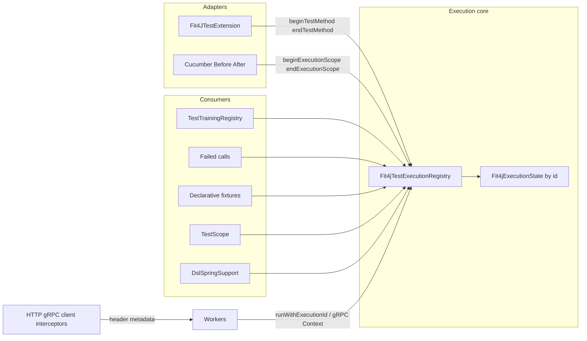

# Execution-id state refactor

Remove ExtensionContext leakage from FIT4J’s runtime by making execution-id–keyed state the single source of truth for trainings, failed calls, test metadata, and ApplicationContext lookup—keeping JUnit’s Fit4JTestExtension as a thin adapter and aligning Cucumber with the same path.

## Problem

Today FIT4J mixes two models:

- **Propagation-friendly:** execution id (ThreadLocal + HTTP/gRPC) and `trainingsByExecutionId`
- **JUnit-leaky:** [`Fit4JTestExtension.currentExtensionContext`](src/main/kotlin/org/fit4j/context/Fit4JTestExtension.kt) (JVM-global) exposed via [`Fit4JTestContextManager.currentExtensionContext()`](src/main/kotlin/org/fit4j/context/Fit4JTestContextManager.kt), used for trainings Store, failed calls, fixtures, `TestScope`, and `DslSpringSupport`

That static fallback blocks same-JVM isolation and forces dual paths in [`TestTrainingRegistry`](src/main/kotlin/org/fit4j/dsl/TestTrainingRegistry.kt). Cucumber already cannot use Jupiter `ExtensionContext`; the long-term model must not require it.

`org.fit4j.context` / `org.fit4j.scope` are outside the binary-compatibility dump ([`build.gradle.kts` `apiValidation.ignoredPackages`](build.gradle.kts)), so this can land as an internal breaking cleanup without `api/fit4j.api` churn—still treat caller-facing behavior carefully in docs/tests.

## Target architecture



**Single source of truth:** `executionId -> Fit4jExecutionState`

```text
Fit4jExecutionState(
  id,
  testClass: Class<*>?,
  testMethod: Method?,
  applicationContext: ApplicationContext?,
  failedCalls: CopyOnWriteArrayList<FailedCall>,
)
```

Trainings stay in [`TestTrainingRegistry`](src/main/kotlin/org/fit4j/dsl/TestTrainingRegistry.kt) as `ConcurrentHashMap<executionId, List<T>>` (one registry instance per protocol object: HTTP / gRPC). Drop `ExtensionContext.Namespace` parameters from [`HttpDslRegistry`](src/main/kotlin/org/fit4j/http/dsl/HttpDslRegistry.kt) / [`GrpcDslRegistry`](src/main/kotlin/org/fit4j/grpc/dsl/GrpcDslRegistry.kt).

**Resolution order (unchanged semantics, fail-closed):** ThreadLocal execution id, then gRPC server context id, else miss. No process-wide `activeScopeId`. No static ExtensionContext fallback.

**JUnit adapter only:** `Fit4JTestExtension` may still *receive* `ExtensionContext` in callbacks, but must not publish it library-wide. On `beforeEach`: create state, set ThreadLocal, attach class/method, resolve and store `ApplicationContext` via `SpringExtension.getApplicationContext(context)`. On `afterEach` / `afterTestExecution`: read failed calls from state by id, reset trainings, clear state + ThreadLocal.

**Cucumber:** keep `beginExecutionScope` / `endExecutionScope`. Optionally enrich scope with AC from the Spring test context in hooks (same state bag). No ExtensionContext.

## Non-goals (explicit)

- Declaring product-complete **same-JVM parallel `@FIT`** support after this alone (shared Spring context, embedded Kafka, Testcontainers proxies, etc. remain). This refactor removes FIT4J’s *execution-context* static leakage for stubs/failed-calls/metadata/scope keys.
- Changing public DSL (`Fit4J.http` / `Fit4J.grpc`) or published Maven coordinates.
- Reintroducing `activeScopeId`.

## Phase 1 — Trainings only (highest risk / SampleGrpcFIT path)

**Goal:** One storage path for stubs; JUnit and Cucumber identical.

1. Change [`TestTrainingRegistry`](src/main/kotlin/org/fit4j/dsl/TestTrainingRegistry.kt):
   - Remove `namespace` and all `ExtensionContext` / `Fit4JTestContextManager` usage.
   - `register` / `resolve` / `resetCurrentTest` use only `resolveTrainingExecutionId()` + `trainingsByExecutionId`.
   - Missing id on `register` → same `IllegalStateException` as today for Cucumber-without-scope.
2. Simplify [`HttpDslRegistry`](src/main/kotlin/org/fit4j/http/dsl/HttpDslRegistry.kt) / [`GrpcDslRegistry`](src/main/kotlin/org/fit4j/grpc/dsl/GrpcDslRegistry.kt) constructors (drop Namespace).
3. Ensure [`beginTestMethod`](src/main/kotlin/org/fit4j/context/Fit4jTestExecutionRegistry.kt) always sets ThreadLocal **before** any DSL registration (already true via `Fit4JTestExtension.beforeEach`).
4. Workers already bind via [`HttpServerDispatcher.runWithExecutionId`](src/main/kotlin/org/fit4j/http/HttpServerDispatcher.kt) and gRPC Context + `resolveTrainingExecutionId()` — verify no Store fallback remains.

**Verify:** `SampleGrpcFIT` override scenario, `TestTrainingRegistryFIT`, `ExecutionScopeTrainingTest`, `GrpcDslFIT`, `HttpMockServiceResponseFactoryFIT` DSL override, [`Fit4jCucumberSpringTest`](src/test/kotlin/org/fit4j/cucumber/Fit4jCucumberSpringTest.kt).

## Phase 2 — Execution state bag + remove static ExtensionContext

**Goal:** Stop leaking `ExtensionContext` through `Fit4JTestContextManager`.

1. Introduce `Fit4jExecutionState` (new type under `org.fit4j.context`, internal or public-as-needed).
2. Extend [`Fit4jTestExecutionRegistry`](src/main/kotlin/org/fit4j/context/Fit4jTestExecutionRegistry.kt):
   - `stateByExecutionId: ConcurrentHashMap<String, Fit4jExecutionState>`
   - `beginTestMethod(ExtensionContext)`: create state with class/method; store AC from `SpringExtension`; keep ThreadLocal; **stop requiring** `contextByExecutionId` for library consumers (map can remain briefly only if needed for migration, then delete).
   - `beginExecutionScope()`: create empty/minimal state (optional AC attach API for Cucumber).
   - `end*` / `closeScope`: remove state + trainings reset (existing registry resets) + clear ThreadLocal.
   - `currentState(): Fit4jExecutionState?` via `resolveTrainingExecutionId()`.
3. Rewrite [`Fit4JTestContextManager`](src/main/kotlin/org/fit4j/context/Fit4JTestContextManager.kt):
   - **Remove** `currentExtensionContext()`.
   - `getTestClass` / `getTestMethod` / names → from `currentState()`.
   - `addFailedCall` / `getFailedCalls` → list on state (not ExtensionContext Store).
4. Remove `Fit4JTestExtension.Companion.currentExtensionContext` static field and all assignments.
5. Update [`Fit4JTestExtension`](src/main/kotlin/org/fit4j/context/Fit4JTestExtension.kt) failed-call assert to use manager APIs backed by state.

**Verify:** `GrpcClientExecutionIdPropagationFIT` (method name on worker), failed-call assertion FITs, any test that relied on Store cleanup between methods.

## Phase 3 — Downstream consumers off ExtensionContext

1. [`DslSpringSupport`](src/main/kotlin/org/fit4j/dsl/DslSpringSupport.kt): `currentApplicationContext()` → `currentState()?.applicationContext` (populated in Phase 2).
2. [`DeclarativeTestFixtureProvider`](src/main/kotlin/org/fit4j/mock/declarative/DeclarativeTestFixtureProvider.kt): keep using `getTestClass` / `getTestMethod` (now state-backed).
3. [`TestScope`](src/main/kotlin/org/fit4j/scope/TestScope.kt): scope conversation id = **execution id** (not `Class.method`), so parallel-ready and Cucumber-safe; clear scoped maps on `endTestMethod` / `endExecutionScope` (registry close hook or explicit `TestScope.cleanup(executionId)` from extension/hooks).
4. [`Fit4JTestContextCustomizer`](src/main/kotlin/org/fit4j/context/Fit4JTestContextCustomizer.kt): confirm class-name property source still works at context customize time (may run before `beforeEach`—if so, keep reading from Spring test class / merged config rather than execution state for *context customization*; do not reintroduce static ExtensionContext).

**Verify:** DSL SpEL/predicate FITs needing AC, fixture selection FITs, any `@TestScope` bean tests.

## Phase 4 — API hygiene, docs, leftover maps

1. Delete dead `contextByExecutionId` / `resolveExtensionContext` if unused.
2. Document in README / wiki parallel note: execution-id isolation for HTTP/gRPC stubs and failed-calls; in-JVM parallel still unsupported for shared infra.
3. Cucumber example KDoc: state/AC attachment if hooks gain `attachApplicationContext`.
4. Ensure `endExecutionScope` clears trainings + failed calls + TestScope entries for that id (parity with JUnit `afterEach`).

## Testing strategy

| Area | Tests |
|------|--------|
| Trainings isolation | `TestTrainingRegistryFIT`, `ExecutionScopeTrainingTest` |
| gRPC worker + DSL override | `SampleGrpcFIT`, `GrpcClientExecutionIdPropagationFIT` |
| HTTP worker + Cucumber | `Fit4jCucumberSpringTest` |
| Failed calls | existing untrained-call FIT(s) that assert extension failure |
| Fixtures | declarative fixture FITs |
| Regression suite | `./gradlew test` (or focused packages then full) |

Add focused unit tests for `Fit4jExecutionState` lifecycle: begin → register → worker `runWithExecutionId` resolve → end → miss; two concurrent ids without static crossover (thread-based, not full JUnit parallel mode).

## Implementation order and PR slicing

1. **PR1:** Phase 1 trainings-only (smallest behavior change surface, highest stub risk).
2. **PR2:** Phase 2 state bag + remove static ExtensionContext + failed calls.
3. **PR3:** Phase 3 TestScope / DslSpringSupport / cleanup + docs.

Do not mix `activeScopeId` or Store dual-write “safety nets” back in; fix missing id propagation instead (RestClient/RestTemplate/gRPC interceptors already present).

## Key files

- [`Fit4jTestExecutionRegistry.kt`](src/main/kotlin/org/fit4j/context/Fit4jTestExecutionRegistry.kt) — core
- [`Fit4JTestExtension.kt`](src/main/kotlin/org/fit4j/context/Fit4JTestExtension.kt) — adapter only
- [`Fit4JTestContextManager.kt`](src/main/kotlin/org/fit4j/context/Fit4JTestContextManager.kt) — no ExtensionContext API
- [`TestTrainingRegistry.kt`](src/main/kotlin/org/fit4j/dsl/TestTrainingRegistry.kt) — map-only
- [`HttpDslRegistry.kt`](src/main/kotlin/org/fit4j/http/dsl/HttpDslRegistry.kt) / [`GrpcDslRegistry.kt`](src/main/kotlin/org/fit4j/grpc/dsl/GrpcDslRegistry.kt)
- [`DslSpringSupport.kt`](src/main/kotlin/org/fit4j/dsl/DslSpringSupport.kt), [`TestScope.kt`](src/main/kotlin/org/fit4j/scope/TestScope.kt)
- Cucumber: [`Fit4jCucumberSpringHooks.kt`](src/test/kotlin/org/fit4j/cucumber/Fit4jCucumberSpringHooks.kt)
